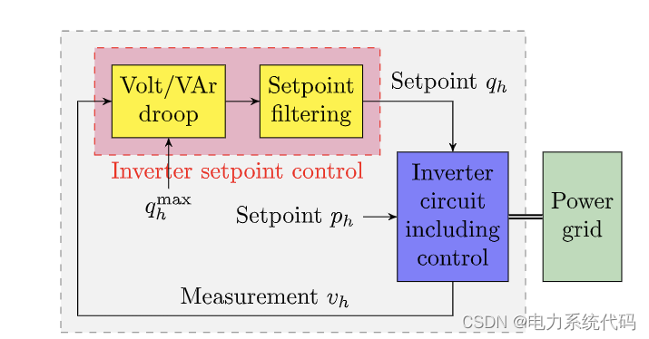
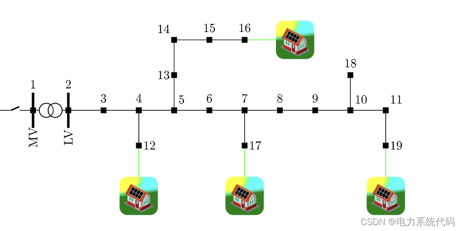
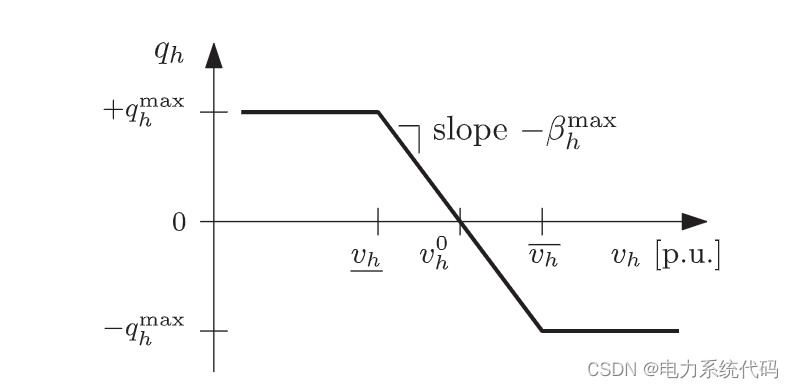
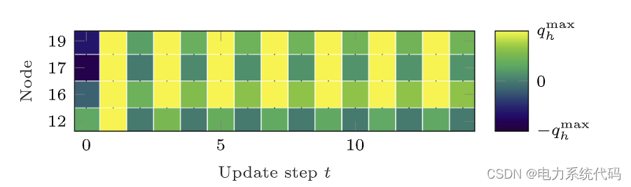
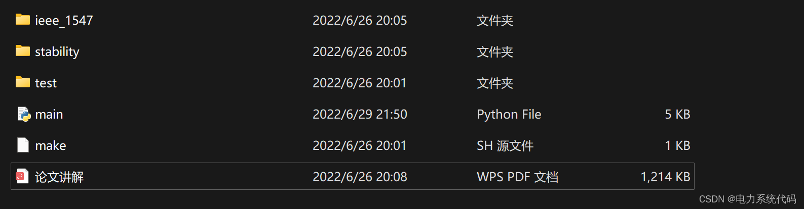
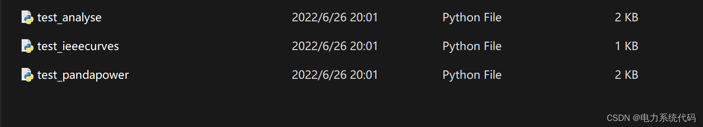
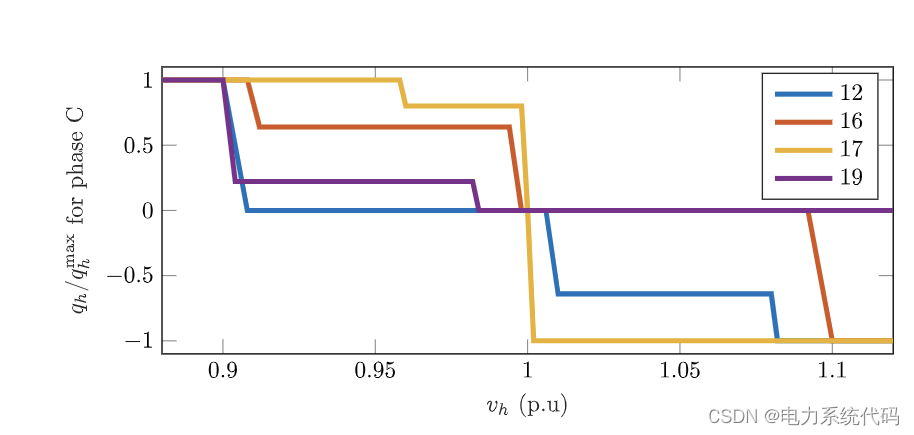
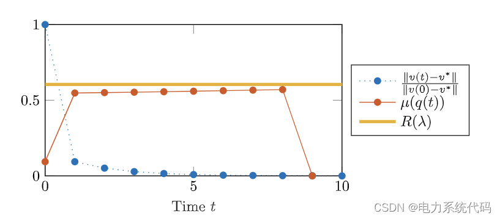
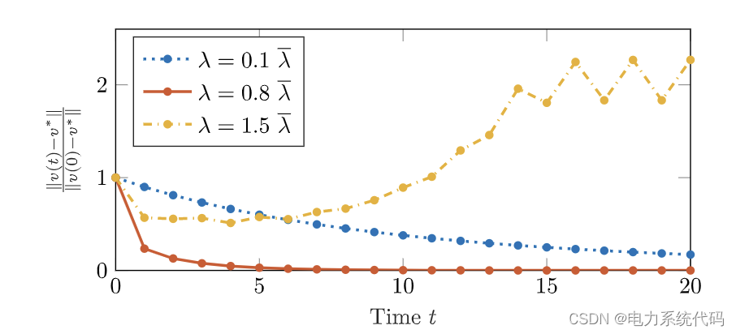

# Analysis of Power Distribution Network Stability (Python Code Implementation)

​  
Contents
I. Overview
II. Distributed Load Management via DER
III. Incentive Case Study
4. Python code implementation
V. Results
Editor
I. Overview: Historically, power generation was conducted at transmission voltage levels by large power plants, while medium and low voltage distribution networks (DNs) were considered as sources of power. However, in the past few decades, a large number of Distributed Energy Resources (DER) such as distributed generators and new types of controllable loads have been installed in DNs. One of the most important modern challenges for distribution system operators (DSOs) is to control power flows in order to avoid violating electrical energy quality constraints. To mitigate these critical power quality issues and achieve more efficient grid utilization, control over most DERs, such as residential photovoltaic (PV) units, can be implemented.
Editor
Editor
2. Distributed Load Flow Management via DER
Based on the available communication and monitoring infrastructure, DER control schemes can broadly be categorized into "centralized," "distributed," and "local." In a centralized scheme, measurements from sensors are collected by a central control unit, which calculates the optimal setpoints for each DER and communicates command signals. A distributed control scheme requires limited communication and can achieve near-optimal system performance without any central computing unit. The communication links can only be used between critical nodes, making this method more cost-effective compared to the centralized approach. However, the primary control architecture mandates that local control schemes, which do not require any communication, are implemented in DNs, containing the most scalable and practical solutions. Each DER adjusts its setpoint based on local measurements according to certain predefined rules. The analysis presented in this paper is applicable to local DER control schemes with a fully decentralized architecture. When presenting our results, we specifically focus on strategies aimed at controlling reactive power flow and avoiding violation of voltage magnitude constraints. Local Volt/VAr controllers differ in terms of control algorithms and required local measurements. In this work, we consider general strategy categories represented in Figure 1, where voltage magnitude measurements serve as inputs to determine the required setpoints for DER reactive power injection through static voltage regulation functions. These setpoints can be filtered before being used as references for power inverter controllers. Figure 2 reports a simple example of the pure local feedback law used for reactive power control.
III. Incentive Case Study
To further motivate our research and emphasize the importance of the proposed analysis, we briefly investigate the stability of the standardized voltage/reactive power curves reported in Figure 2, where we determine design parameters based on recommendations from multiple modern grid standards. According to these standards, high (low) local voltage magnitudes will trigger reactive power consumption (injection). The absorption (generation) of reactive power alleviates local overvoltage (undervoltage). However, as shown in the following example, this feedback pattern is unstable in operational regions: Let's consider Baseline Distribution Network 1 shown in Figure 3, characterized by four distributed generators (DG) connected to the Cigre baseline low-voltage test system. We set all active and reactive loads and active power injections to keep all 19 nodes at constant values. By initializing the simulation with a random value for the initial DG reactive power injection, and then adjusting according to the control curve, all nodes are considered PQ nodes in subsequent flow calculations. As shown in Figure 4, the reactive power injection does not converge, remaining in a continuous limit cycle. The time interval between updates is chosen to decay all inverter dynamics between subsequent setpoint updates. This simple example has inspired our study on the stability of this local voltage/reactive control scheme. It is important to note that in this example and throughout this paper, we assume that DERs periodically adjust their reactive power injection based on its measurement values, and t is an index for such iterative updates. The actual absolute time between two iterations does not affect our analysis as long as it is longer than the stable time of the power converter and the grid dynamics.
Editor
Figure 4
IV. Python Code Implementation
Editor
This article only showcases part of it; you need to click here to see the whole thing:
V. Results
Editor

## Images

<!-- PAYMENT_BLOCK -->

## Get this dataset

- Payment link (Stripe): [Buy now](https://buy.stripe.com/3cs8yP7sY87d0vu9AB)
- Payment QR code: 

<!-- /PAYMENT_BLOCK -->
